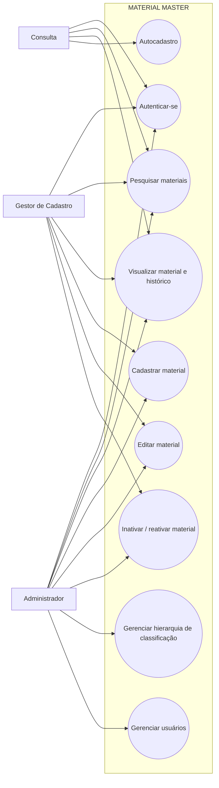
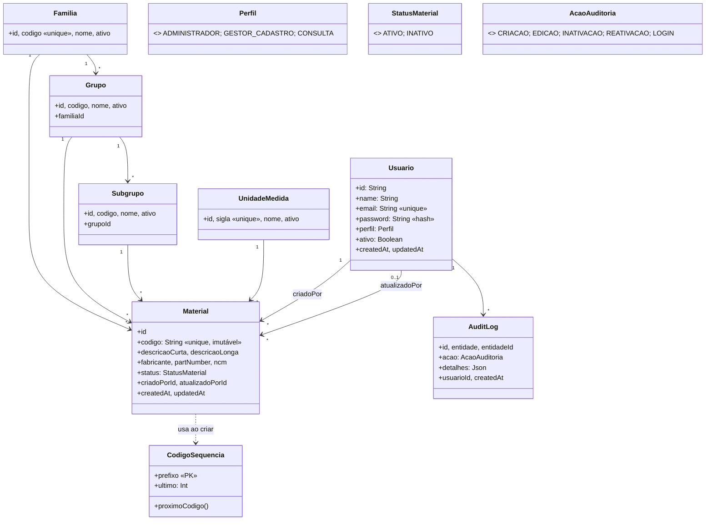
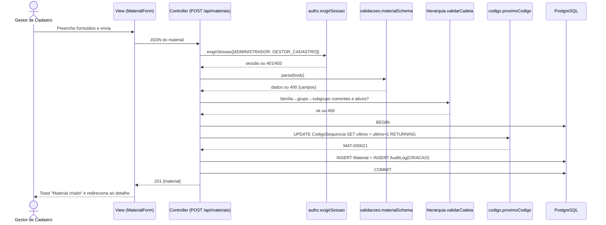
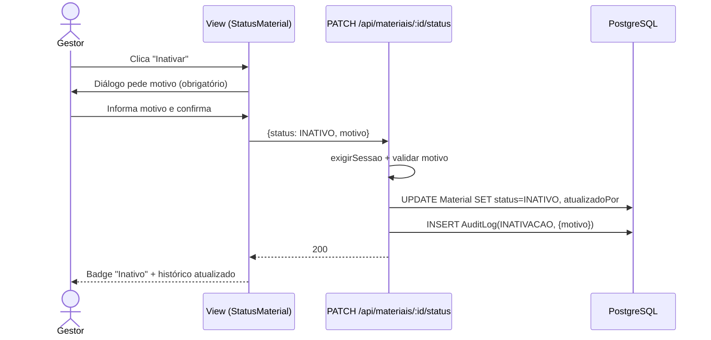
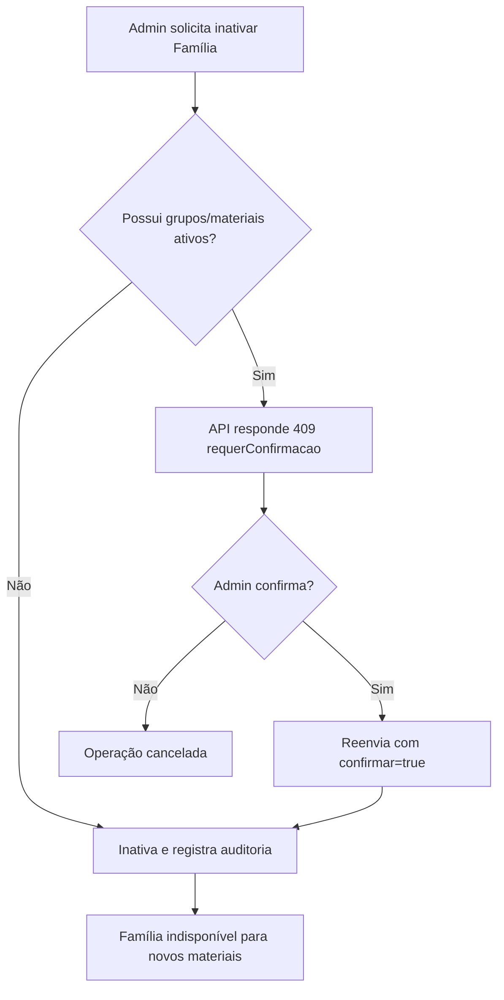
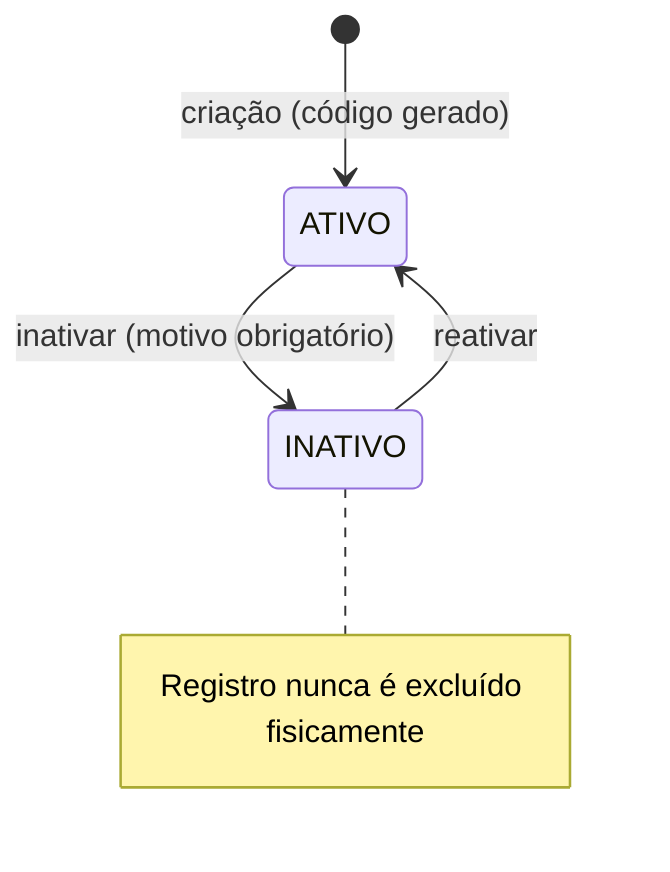

# 02 — Modelagem UML

Diagramas em sintaxe Mermaid (renderizam no GitHub, VS Code e em https://mermaid.live).

## 2.1 Diagrama de casos de uso

## 2.2 Diagrama de classes (domínio / persistência)

## 2.3 Diagrama de sequência — Cadastrar material

## 2.4 Diagrama de sequência — Inativar material

## 2.5 Diagrama de atividades — Inativar classificação em uso

## 2.6 Diagrama de estados — Material

