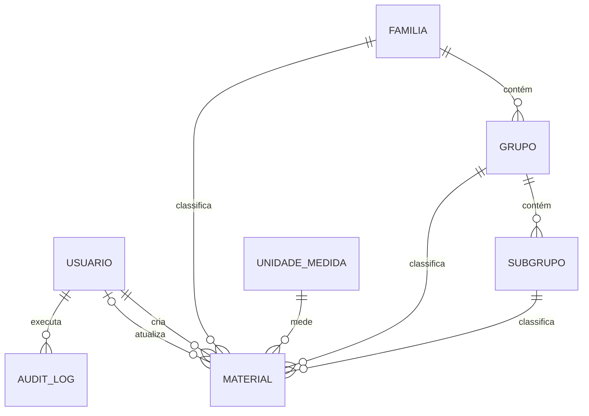

# 03 — Projeto de banco de dados

SGBD escolhido: **PostgreSQL** (relacional, popular, de fácil manutenção — conforme orientação da disciplina de não usar SGBD obscuro).

## 3.1 Projeto conceitual (DER)



## 3.2 Projeto lógico normalizado (3FN)

- **User**(id PK, name, email UK, password, perfil, ativo, createdAt, updatedAt)
- **Familia**(id PK, codigo UK, nome, ativo, createdAt, updatedAt)
- **Grupo**(id PK, codigo, nome, ativo, familiaId FK→Familia, createdAt, updatedAt) — UK(familiaId, codigo)
- **Subgrupo**(id PK, codigo, nome, ativo, grupoId FK→Grupo, createdAt, updatedAt) — UK(grupoId, codigo)
- **UnidadeMedida**(id PK, sigla UK, nome, ativo, createdAt)
- **CodigoSequencia**(prefixo PK, ultimo)
- **Material**(id PK, codigo UK, descricaoCurta, descricaoLonga, unidadeMedidaId FK, familiaId FK, grupoId FK, subgrupoId FK, fabricante, partNumber, ncm, status, criadoPorId FK→User, atualizadoPorId FK→User, createdAt, updatedAt)
- **AuditLog**(id PK, entidade, entidadeId, acao, detalhes JSONB, usuarioId FK→User, createdAt)

Justificativa de normalização: nenhum atributo multivalorado (1FN); todas as chaves são simples, logo não há dependência parcial (2FN); descrições de família/grupo/subgrupo/unidade ficam em suas próprias tabelas, evitando dependência transitiva em Material (3FN). A redundância controlada `familiaId` e `grupoId` em Material é intencional para consultas e filtros rápidos; a coerência da cadeia é garantida na camada de aplicação (`lib/hierarquia.ts`) e coberta por teste automatizado.

## 3.3 Projeto físico (DDL equivalente ao gerado pelas migrações)

```sql
CREATE TYPE "Perfil" AS ENUM ('ADMINISTRADOR','GESTOR_CADASTRO','CONSULTA');
CREATE TYPE "StatusMaterial" AS ENUM ('ATIVO','INATIVO');
CREATE TYPE "AcaoAuditoria" AS ENUM ('CRIACAO','EDICAO','INATIVACAO','REATIVACAO','LOGIN');

CREATE TABLE "User" (
  id TEXT PRIMARY KEY, name TEXT NOT NULL, email TEXT NOT NULL UNIQUE,
  password TEXT NOT NULL, perfil "Perfil" NOT NULL DEFAULT 'CONSULTA',
  ativo BOOLEAN NOT NULL DEFAULT TRUE,
  "createdAt" TIMESTAMP(3) NOT NULL DEFAULT CURRENT_TIMESTAMP, "updatedAt" TIMESTAMP(3) NOT NULL);
CREATE INDEX ON "User"(perfil); CREATE INDEX ON "User"(ativo);

CREATE TABLE "Familia" (id TEXT PRIMARY KEY, codigo TEXT NOT NULL UNIQUE, nome TEXT NOT NULL,
  ativo BOOLEAN NOT NULL DEFAULT TRUE, "createdAt" TIMESTAMP(3) NOT NULL DEFAULT CURRENT_TIMESTAMP, "updatedAt" TIMESTAMP(3) NOT NULL);

CREATE TABLE "Grupo" (id TEXT PRIMARY KEY, codigo TEXT NOT NULL, nome TEXT NOT NULL, ativo BOOLEAN NOT NULL DEFAULT TRUE,
  "familiaId" TEXT NOT NULL REFERENCES "Familia"(id),
  "createdAt" TIMESTAMP(3) NOT NULL DEFAULT CURRENT_TIMESTAMP, "updatedAt" TIMESTAMP(3) NOT NULL,
  UNIQUE ("familiaId", codigo));

CREATE TABLE "Subgrupo" (id TEXT PRIMARY KEY, codigo TEXT NOT NULL, nome TEXT NOT NULL, ativo BOOLEAN NOT NULL DEFAULT TRUE,
  "grupoId" TEXT NOT NULL REFERENCES "Grupo"(id),
  "createdAt" TIMESTAMP(3) NOT NULL DEFAULT CURRENT_TIMESTAMP, "updatedAt" TIMESTAMP(3) NOT NULL,
  UNIQUE ("grupoId", codigo));

CREATE TABLE "UnidadeMedida" (id TEXT PRIMARY KEY, sigla TEXT NOT NULL UNIQUE, nome TEXT NOT NULL,
  ativo BOOLEAN NOT NULL DEFAULT TRUE, "createdAt" TIMESTAMP(3) NOT NULL DEFAULT CURRENT_TIMESTAMP);

CREATE TABLE "CodigoSequencia" (prefixo TEXT PRIMARY KEY, ultimo INTEGER NOT NULL DEFAULT 0);

CREATE TABLE "Material" (
  id TEXT PRIMARY KEY, codigo TEXT NOT NULL UNIQUE,
  "descricaoCurta" TEXT NOT NULL, "descricaoLonga" TEXT,
  "unidadeMedidaId" TEXT NOT NULL REFERENCES "UnidadeMedida"(id),
  "familiaId" TEXT NOT NULL REFERENCES "Familia"(id),
  "grupoId" TEXT NOT NULL REFERENCES "Grupo"(id),
  "subgrupoId" TEXT NOT NULL REFERENCES "Subgrupo"(id),
  fabricante TEXT, "partNumber" TEXT, ncm TEXT,
  status "StatusMaterial" NOT NULL DEFAULT 'ATIVO',
  "criadoPorId" TEXT NOT NULL REFERENCES "User"(id),
  "atualizadoPorId" TEXT REFERENCES "User"(id),
  "createdAt" TIMESTAMP(3) NOT NULL DEFAULT CURRENT_TIMESTAMP, "updatedAt" TIMESTAMP(3) NOT NULL);
CREATE INDEX ON "Material"(status); CREATE INDEX ON "Material"("familiaId");
CREATE INDEX ON "Material"("grupoId"); CREATE INDEX ON "Material"("subgrupoId");
CREATE INDEX ON "Material"("descricaoCurta"); CREATE INDEX ON "Material"("createdAt");

CREATE TABLE "AuditLog" (id TEXT PRIMARY KEY, entidade TEXT NOT NULL, "entidadeId" TEXT NOT NULL,
  acao "AcaoAuditoria" NOT NULL, detalhes JSONB,
  "usuarioId" TEXT NOT NULL REFERENCES "User"(id),
  "createdAt" TIMESTAMP(3) NOT NULL DEFAULT CURRENT_TIMESTAMP);
CREATE INDEX ON "AuditLog"(entidade, "entidadeId"); CREATE INDEX ON "AuditLog"("usuarioId"); CREATE INDEX ON "AuditLog"("createdAt");
```

## 3.4 Geração segura do código de material

```sql
-- executado dentro de transação, com bloqueio de linha
UPDATE "CodigoSequencia" SET ultimo = ultimo + 1 WHERE prefixo = 'MAT' RETURNING ultimo;
-- código = 'MAT-' || lpad(ultimo::text, 6, '0')
```
O teste de integração dispara 25 criações simultâneas e verifica 25 códigos únicos e sequenciais.

## 3.5 Carga inicial (seed)
6 famílias (Elétricos, Mecânicos, Hidráulicos, EPIs, Lubrificantes e Químicos, …), grupos e subgrupos derivados, unidades de medida (UN, PC, M, KG, L, CX, PAR, RL…), cerca de 20 materiais de exemplo e três usuários de demonstração, um por perfil (senhas padrão apenas em desenvolvimento; em produção o seed usa as variáveis `SEED_SENHA_*` ou gera senhas aleatórias). O seed usa `upsert` e pode ser reexecutado sem duplicar dados.
